# В этой ветке описание проделанной работы

## Задание

1. Зарегистрироваться на GitHub.
2. Добавить SSH-ключ или активировать 2FA.
3. Создать репозиторий на GitHub.
4. Создать локальный репозиторий с файлом `README.md`, внести изменения.
5. Запушить на удалённый сервер.
6. Отработать механизм разрешения конфликтов.

---

## Выполнение задания

### 1. Настройка двухфакторной аутентификации

Настроил 2FA для аккаунта GitHub.

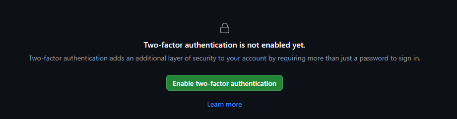
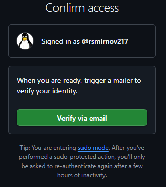
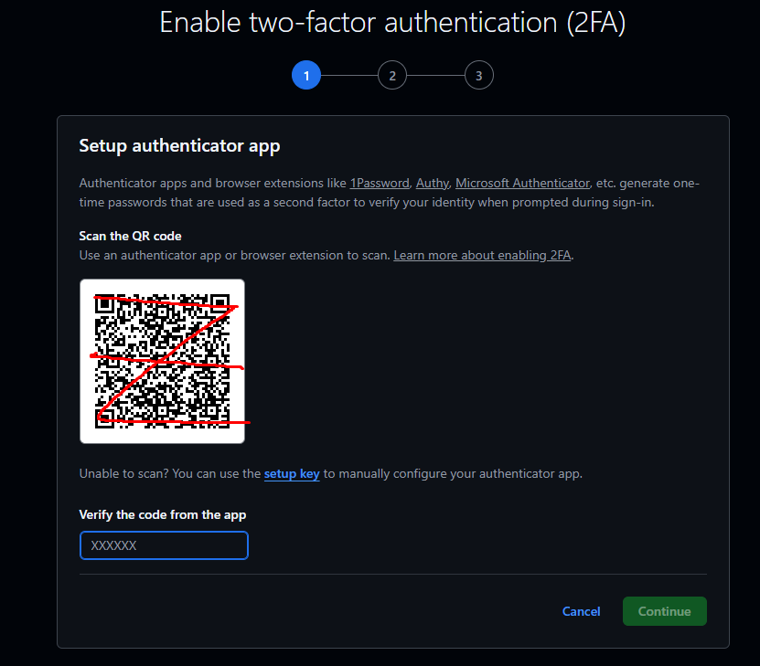
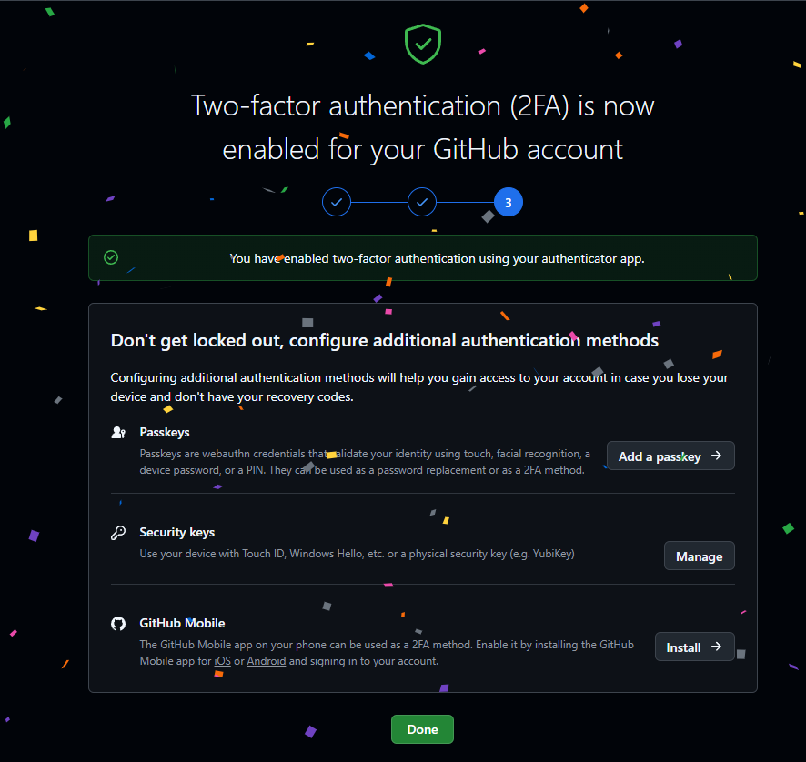

### 2. Создание репозитория на GitHub

Создал пустой репозиторий на сайте GitHub.

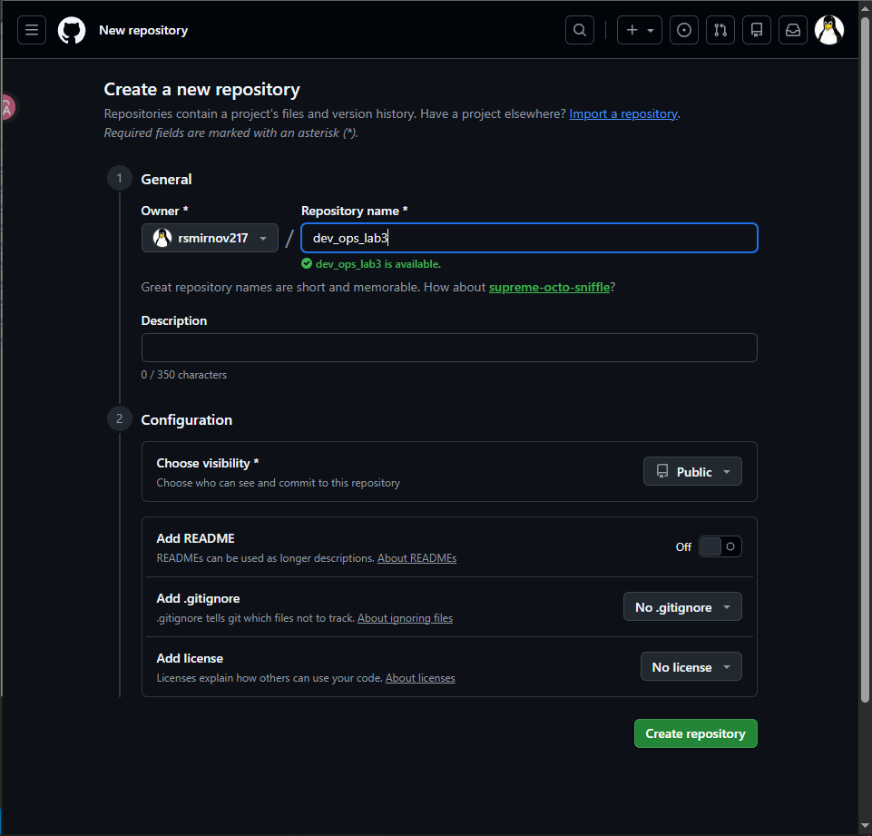

### 3. Инициализация локального репозитория

Инициализировал локальный репозиторий.

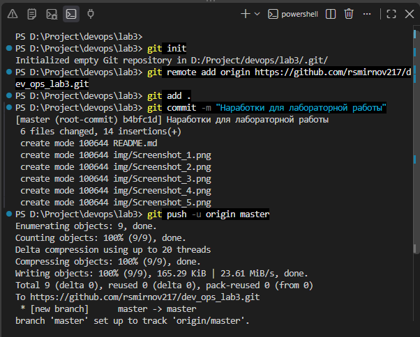

### 4. Генерация SSH-ключа

Перешёл на виртуальную машину, сгенерировал SSH-ключ и добавил его в GitHub.

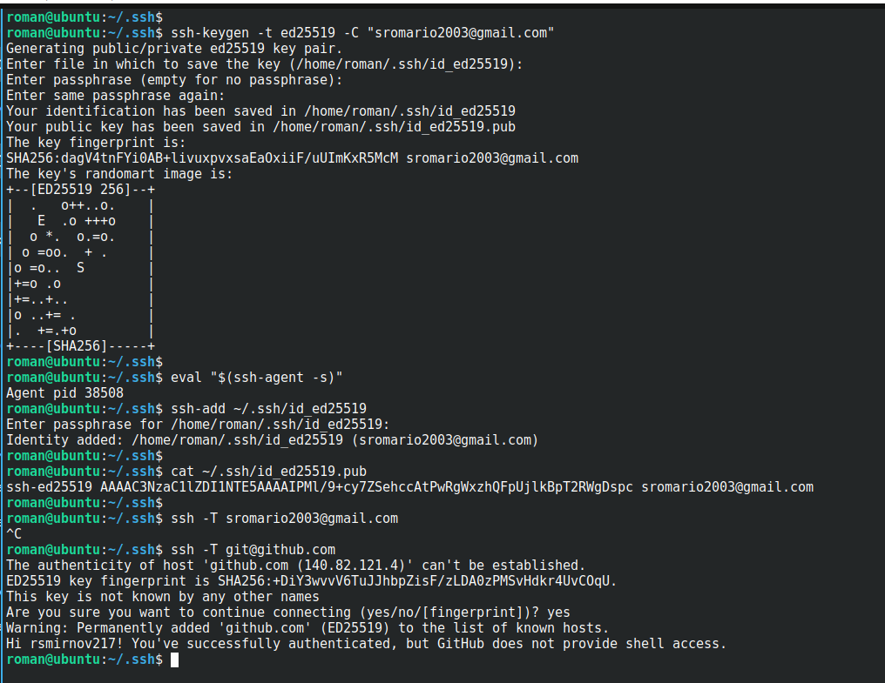

### 5. Клонирование и изменения

Клонировал репозиторий и внёс изменения локально.

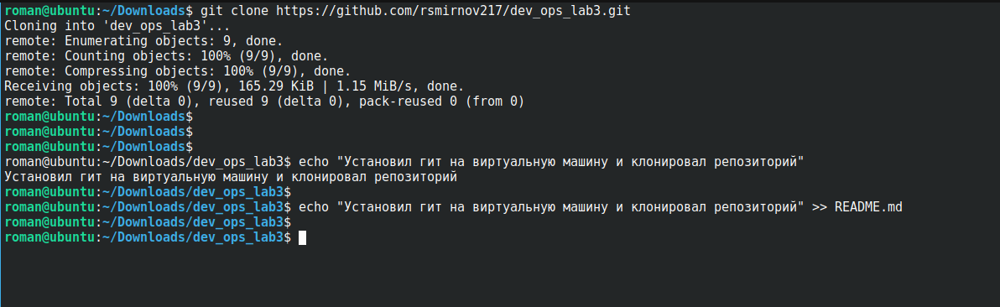
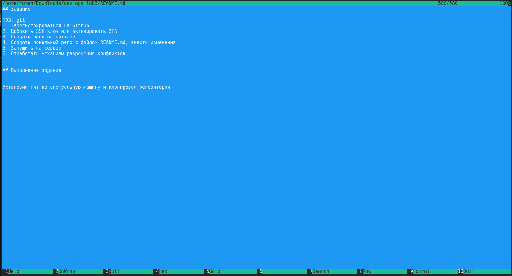

### 6. Ошибка при пуше

Попытался запушить на удалённый сервер — получил ошибку.

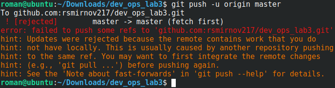

### 7. Разрешение конфликта

Решил слить изменения.

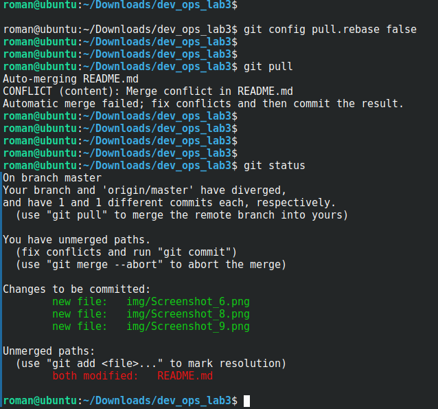

Так выглядел файл после попытки слить изменения:

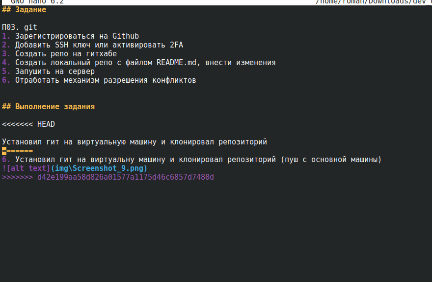

Внёс правки и запушил в ветку `origin master`.

### 8. Новая ветка с основной машины

Перешёл на основную машину, создал новую ветку и запушил изменения.

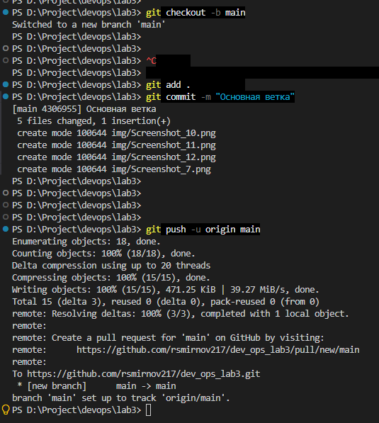
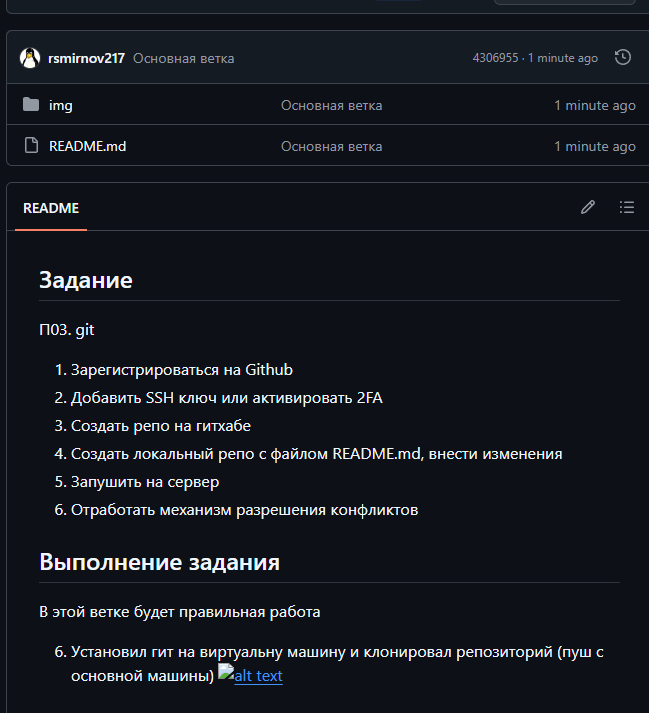